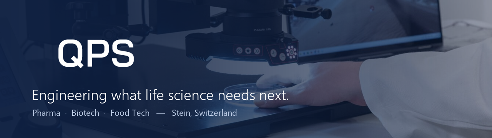

  

<h1 align="center">QPS Engineering AG</h1>

  <a href="https://qpsag.com">Website</a> ·
  <a href="https://shop.qpsag.com">Shop</a> ·
  <a href="https://www.linkedin.com/company/qps-engineering-schweiz/">LinkedIn</a> ·
  <a href="mailto:info@qpsag.com">info@qpsag.com</a>

---

QPS Engineering AG is a Swiss engineering company based in Stein (AG), founded in 2017.
We support pharmaceutical, biotech and food manufacturers in building, qualifying and digitalising
their production in GxP-regulated environments.

## What we do

| Division | Focus |
|---|---|
| **Qengineering** | Project management, qualification and validation, GMP compliance, fill & finish, packaging |
| **Qlabs** | Visual inspection: defect test sets, laser-drilled reference containers, training, container closure integrity testing (CCIT) |
| **Qmeasure** | Measurement technology: material identification, surface roughness, light intensity, temperature, noise level |
| **QxTec** | Digital transformation: robotic and AI-based visual inspection, robotic systems, AI business solutions, selection and integration |

## Software at QPS

Our software work centres on industrial automation and vision for regulated production:
AI-assisted visual inspection, robot integration, HMI applications and tools that support
validation and GxP documentation. Most of this work is developed for and with our customers
and is therefore not public.

## Contact

**QPS Engineering AG**
Schaffhauserstrasse 30, 4332 Stein, Switzerland
+41 56 281 91 14 · [info@qpsag.com](mailto:info@qpsag.com) · [qpsag.com](https://qpsag.com)

To report a security issue, see our [security policy](https://github.com/qpsagcom/.github/blob/main/SECURITY.md).
